# Application runtimes

The runtime directory owns executable entrypoints, startup ordering, and process
lifecycle coordination. HTTP serves requests; the background process runs all
queue workers and scheduled jobs.

## Directory layout

```text
runtime/
  process/
    http.process.ts
    background.process.ts
    __specs__/
  servers/
    express/
      index.ts
      cors.ts
      rate-limiter.ts
      swagger.ts
      __specs__/
  health/
    index.ts
    __specs__/
      index.spec.ts
  bootstrap/
    accounting-context.bootstrap.ts
    currencies.bootstrap.ts
    events.bootstrap.ts
    feature-flag.bootstrap.ts
    observability.bootstrap.ts
    __specs__/
  lifecycle/
    background-runtime.lifecycle.ts
    feature-flag.lifecycle.ts
    observability.lifecycle.ts
    queue.lifecycle.ts
    __specs__/
  __docs__/
    README.md
```

Executable entrypoints live under `process/`. Runtime support includes concrete
listener setup under `servers/express/`. Double-underscore directories contain
documentation or tests.

| Location                        | Responsibility                                                                      |
| ------------------------------- | ----------------------------------------------------------------------------------- |
| `process/http.process.ts`       | Start HTTP and coordinate its dependency bootstrap.                                 |
| `process/background.process.ts` | Initialize observability and invoke the background lifecycle.                       |
| `servers/express/`              | Configure Express-specific adapters and start the HTTP listener.                    |
| `health/`                       | Track startup readiness and probe PostgreSQL independently of Express.              |
| `bootstrap/`                    | Initialize dependencies and register handlers when explicitly invoked by a runtime. |
| `lifecycle/`                    | Coordinate resource initialization, shutdown, and telemetry flushing.               |

## Runtime chart

Arrows show startup and execution order in the two independent processes.

```mermaid
flowchart TD
    subgraph HTTP["HTTP process"]
        H0["process/http.process.ts"] --> H1["Initialize Sentry"]
        H1 --> H2["Dynamically load application dependencies"]
        H2 --> H3["Configure OAuth and Express; begin listening"]
        H3 --> H4["Listening callback: initialize feature flags and register shutdown"]
        H4 --> H5["Bootstrap currencies"]
        H5 --> H6["Bootstrap accounting reference data"]
        H6 --> H8["Subscribe user event handlers"]
        H8 --> H9["Mark startup complete"]
        H9 --> H10["Serve requests and enqueue work"]
    end

    subgraph BACKGROUND["Background process"]
        I0["process/background.process.ts"] --> I1["Initialize observability"]
        I1 --> I2["Register all queue workers through messaging"]
        I2 --> I3["Initialize schedules and run overdue exchange-rate ingestion"]
        I3 --> I4["Start node-cron tasks"]
        I2 --> I5["Process email, ledger balances, and accounting periods"]
        I4 --> I6["Daily exchange-rate ingestion and hourly period discovery"]
    end
```



Both entrypoints initialize observability before dynamically importing the
application dependency graph. Preserve that ordering for automatic instrumentation.

## HTTP process

[`process/http.process.ts`](../process/http.process.ts) supplies the bootstrap callback to the
[server](../servers/express/index.ts). The server starts listening before that callback
finishes. [Readiness](../health/index.ts) requires both successful startup and
a successful PostgreSQL probe; listening alone does not mean the application is
ready. Bootstrap failure marks startup as failed.

The accounting-context bootstrap initializes accounting standards, jurisdictions,
and their permitted combinations. It does not create an accounting entity's
working context.

HTTP enqueues work. The background process starts the
[worker registration array](../../messaging/workers/index.ts), which contains
transactional-email, ledger-balance, and current-accounting-period workers.
Bull Board remains available through HTTP for inspecting queued work.

The [HTTP application](../../../interface/http/application.ts), health route,
and MCP HTTP route remain in `src/interface/http`. MCP tool registration and
protocol definitions remain in `src/interface/mcp`; the HTTP transport adapter
remains in `src/interface/http/handlers/mcp-route.handler.ts`. MCP shares the
HTTP listener and has no separate runtime or infrastructure server.

## Background process

The background runtime runs all queue workers and scheduled jobs independently of HTTP.
Schedules live in `src/infra/scheduling`, separate from messaging queues.

Every queue requires `add(correlationId, payload)`. Producers read the ID from
their app context and pass it as the first argument. The message envelope carries
that ID alongside trace metadata; business DTOs contain only job inputs.

Before invoking a worker, the shared queue adapter initializes an isolated app
context with the envelope’s correlation ID. Workers and use cases read it from
that context. Retries retain the producer’s ID and start with fresh context state.

Start it with:

- Development: `yarn dev:background`
- Production: `yarn start:background`

Run one background instance. Apply migrations and let HTTP complete currency
bootstrap before the first ingestion.

Exchange rates are ingested daily at 6:00 PM Africa/Lagos. On startup, ingestion
also runs if no successful run was recorded yesterday or today.

On shutdown, the runtime stops schedules and waits up to 60 seconds for active
scheduled jobs. Messaging then drains all queue workers, closes producers, and
disconnects Redis before the runtime closes the database and telemetry.

See [operations](../../../../docs/observability-operations.md#cbn-exchange-rate-worker)
for deployment, recovery, and monitoring details.

## Shared support and ownership

- **Bootstrap:** each runtime calls only the initialization it needs. The HTTP
  entrypoint initializes feature flags and reference data and registers event
  handlers. The background runtime invokes the messaging worker registrations.
  Scheduled job initializers own their prerequisites and startup catch-up behavior;
  the background runtime starts their node-cron tasks.
- **Lifecycle:** the HTTP feature-flag lifecycle handles `SIGINT` and `SIGTERM`,
  closes LaunchDarkly, shuts down observability, and exits.
  The background runtime delegates task shutdown to node-cron and closes its own clients.
  The current HTTP lifecycle does not explicitly drain HTTP requests
  or close database and Redis connections.
- **Services:** execution-context storage lives in
  [`infra/services/app-context.service.ts`](../../services/app-context.service.ts).
  Flag evaluation lives in
  [`infra/services/feature-flag.service.ts`](../../services/feature-flag.service.ts).
  Their capability contracts are separate from runtime startup and shutdown.
- **Application behaviour:** use cases coordinate application work and
  persistence. Runtime code owns invocation and process concerns; provider
  clients and SDK lifecycle remain in their integration folders.

## Running and testing

Run these commands from the repository root:

| Command                                  | Behaviour                                              |
| ---------------------------------------- | ------------------------------------------------------ |
| `yarn dev`                               | Watch HTTP and generate routes.                        |
| `yarn dev:background`                    | Watch the background runtime independently.            |
| `yarn start:background`                  | Run the compiled standalone background process.        |
| `yarn start`                             | Apply migrations, then start compiled HTTP.            |
| `yarn start:http`                        | Run compiled HTTP without migrations.                  |
| `npm run test:types`                     | Type-check source and tests.                           |
| `npx jest src/infra/runtime --runInBand` | Run the runtime specs with mocked external boundaries. |

Production commands require built output. See the
[deployment documentation](../../../../docs/07_deployment_view.md) for operational
configuration and readiness handling. Runtime specs stay beside their subjects
in `__specs__/`.
