# Application runtimes

The runtime directory owns executable entrypoints, startup ordering, and process
lifecycle coordination. HTTP serves requests; the background process runs all
queue workers and scheduled jobs.

## Directory layout

```text
runtime/
  process/
    http.process.ts
    background.process.ts
    __specs__/
  servers/
    express/
      index.ts
      cors.ts
      rate-limiter.ts
      swagger.ts
      __specs__/
  health/
    index.ts
    __specs__/
      index.spec.ts
  bootstrap/
    accounting-context.bootstrap.ts
    currencies.bootstrap.ts
    events.bootstrap.ts
    observability.bootstrap.ts
    queue-workers.bootstrap.ts
    __specs__/
  lifecycle/
    background-runtime.lifecycle.ts
    http-runtime.lifecycle.ts
    observability.lifecycle.ts
    queue.lifecycle.ts
    __specs__/
  __docs__/
    README.md
```

Executable entrypoints live under `process/`. Runtime support includes concrete
listener setup under `servers/express/`. Double-underscore directories contain
documentation or tests.

| Location                        | Responsibility                                                                      |
| ------------------------------- | ----------------------------------------------------------------------------------- |
| `process/http.process.ts`       | Initialize observability and invoke the HTTP lifecycle.                             |
| `process/background.process.ts` | Initialize observability and invoke the background lifecycle.                       |
| `servers/express/`              | Configure Express-specific adapters and start the HTTP listener.                    |
| `health/`                       | Track startup readiness and probe PostgreSQL independently of Express.              |
| `bootstrap/`                    | Initialize dependencies and register handlers when explicitly invoked by a runtime. |
| `lifecycle/`                    | Coordinate resource initialization, shutdown, and telemetry flushing.               |

## Runtime chart

Arrows show startup and execution order in the two independent processes.

```mermaid
flowchart TD
    subgraph HTTP["HTTP process"]
        H0["process/http.process.ts"] --> H1["Initialize Sentry"]
        H1 --> H2["Dynamically load HTTP coordinator"]
        H2 --> H2A["HTTP lifecycle: register shutdown handlers"]
        H2A --> H2B["Load application dependencies under cleanup ownership"]
        H2B --> H3["Configure OAuth and Express; begin listening"]
        H3 --> H4["HTTP lifecycle: await listening, then initialize feature flags"]
        H4 --> H5["Bootstrap currencies"]
        H5 --> H6["Bootstrap accounting reference data"]
        H6 --> H8["Subscribe user event handlers"]
        H8 --> H9["Mark startup complete"]
        H9 --> H10["Serve requests and enqueue work"]
    end

    subgraph BACKGROUND["Background process"]
        I0["process/background.process.ts"] --> I1["Initialize observability"]
        I1 --> I2["Invoke queue worker bootstrap registrations"]
        I2 --> I3["Initialize schedules and run overdue exchange-rate ingestion"]
        I3 --> I4["Start node-cron tasks"]
        I2 --> I5["Process email, ledger balances, and accounting periods"]
        I4 --> I6["Daily exchange-rate ingestion and hourly period discovery"]
    end
```



Both entrypoints initialize observability before dynamically importing the
application dependency graph. Preserve that ordering for automatic instrumentation.

## HTTP process

The [HTTP lifecycle](../lifecycle/http-runtime.lifecycle.ts) registers shutdown
signals before loading application dependencies. It starts the listener, then
initializes feature flags, currencies, accounting reference data, and event
handlers in order. Feature-flag initialization is best-effort; its lazy client
is created only when used, and cleanup never creates an unused client.

`GET /health/ready` requires completed startup and a bounded PostgreSQL probe;
it rechecks shutdown state after the probe. `GET /health/live` checks only that
HTTP responds. Both routes run before product middleware. Redis and outbound
integrations do not determine readiness.

On `SIGINT` or `SIGTERM`, the runtime:

1. Marks readiness false and closes the HTTP listener once any pending bind
   settles. `server.close()` drains active HTTP connections.
2. Waits for any running initializer; subsequent startup steps are skipped.
3. Closes LaunchDarkly, messaging producers and Redis, PostgreSQL, then
   observability. Dependencies stay available until draining and initialization
   settle. HTTP does not start queue workers.

Work continuing after a client disconnects or a response ends is not tracked
separately and may encounter closed dependencies. The runtime does not
force-close active requests or interrupt initializers; the supervisor owns the
final termination deadline.

Repeated signals share one cleanup operation. Normal signal exit statuses are
`130` for `SIGINT` and `143` for `SIGTERM`. Application-loading, bootstrap, and
listener-binding failures report `runtime.startup.failed`; subsequent listener
errors report `runtime.server.failed`. Both trigger cleanup and exit status `1`.
Cleanup failures report `runtime.http.cleanup_failed` with the resource in
`source`, set exit status `1`, and allow remaining cleanup to proceed. Provider
cleanup retains its own best-effort reporting.

The accounting-context bootstrap initializes accounting standards, jurisdictions,
and their permitted combinations. It does not create an accounting entity's
working context.

HTTP enqueues work. The background process starts the
[worker bootstrap registrations](../bootstrap/queue-workers.bootstrap.ts), which contain
transactional-email, ledger-balance, and current-accounting-period workers.
Bull Board remains available through HTTP for inspecting queued work.

The [HTTP application](../../../interface/http/application.ts), health route,
and MCP HTTP route remain in `src/interface/http`. MCP tool registration and
protocol definitions remain in `src/interface/mcp`; the HTTP transport adapter
remains in `src/interface/http/handlers/mcp-route.handler.ts`. MCP shares the
HTTP listener and has no separate runtime or infrastructure server.

## Background process

The background runtime runs all queue workers and scheduled jobs independently of HTTP.
Schedules live in `src/infra/scheduling`, separate from messaging queues.

Every queue requires `add(correlationId, payload)`. Producers read the ID from
their app context and pass it as the first argument. The message envelope carries
that ID alongside trace metadata; business DTOs contain only job inputs.

Before invoking a worker, the shared queue adapter initializes an isolated app
context with the envelope’s correlation ID. Workers and use cases read it from
that context. Retries retain the producer’s ID and start with fresh context state.

For service commands, instance count, and bootstrap prerequisites, see the
[deployment guide](../../../../docs/07_deployment_view.md#72-deployment-mapping-and-artifacts).

Exchange rates are ingested daily at 6:00 PM Africa/Lagos. On startup, ingestion
also runs if no successful run was recorded yesterday or today.

On shutdown, the runtime stops schedules and waits up to 60 seconds for active
scheduled jobs. The [queue lifecycle](../lifecycle/queue.lifecycle.ts) then drains
all initialized workers, closes producers, and delegates Redis cleanup to its
connection owner before the runtime closes the database and telemetry.

See [operations](../../../../docs/observability-operations.md#cbn-exchange-rate-worker)
for deployment, recovery, and monitoring details.

## Shared support and ownership

- **Bootstrap and lifecycle:** each runtime owns its initialization, signals,
  cleanup ordering, and protection against repeated shutdown. Concrete SDK
  initialization and cleanup stay with their integrations.
- **Queue resources:** producer implementations and worker bootstrap registrations
  register created resources with the queue lifecycle. It owns the resource
  registry and shared shutdown promise, attempts all cleanup before reporting
  failures, and never creates unused queues, workers, or Redis connections.
  The background runtime invokes worker registrations individually and stops
  further registration when shutdown begins.
- **Queue instrumentation:** [queue tracing](../../observability/queue-tracing.ts)
  owns message trace envelopes and processing spans alongside queue metrics.
  The message envelope format is independent of this code's file placement.
- **Messaging structure:** `infra/messaging` contains its composition barrel and
  subdirectories for messaging implementations. Queue and worker directories
  contain their concrete implementations and composition, with colocated tests
  and documentation. Bootstrap, instrumentation, and lifecycle support live with
  the owners above.
- **Services:** execution-context storage lives in
  [`infra/services/app-context.service.ts`](../../services/app-context.service.ts).
  Flag evaluation lives in
  [`infra/services/feature-flag.service.ts`](../../services/feature-flag.service.ts).
  Their capability contracts are separate from runtime startup and shutdown.
- **Application behaviour:** use cases coordinate application work and
  persistence. Runtime code owns invocation and process concerns; provider
  clients and SDK lifecycle remain in their integration folders.

## Running and testing

See [CONTRIBUTING](../../../../CONTRIBUTING.md#testing) for local commands and
HTTP test fixtures, and the [deployment guide](../../../../docs/07_deployment_view.md#72-deployment-mapping-and-artifacts)
for Coolify configuration. Runtime specs stay beside their subjects in
`__specs__/`.
