# Application runtimes

The runtime directory owns executable entrypoints, startup ordering, and process
lifecycle coordination. The application currently has a long-running HTTP process
and a separate exchange-rate ingestion process that exits after its run.

## Directory layout

```text
runtime/
  _http/
    index.ts
  _background/
    ingestion/
      exchange-rate/
        index.ts
        exchange-rate-ingestion.runtime.ts
        __specs__/
  servers/
    express/
      index.ts
      cors.ts
      rate-limiter.ts
      swagger.ts
      __specs__/
  health/
    index.ts
    __specs__/
      index.spec.ts
  bootstrap/
    accounting-context.bootstrap.ts
    currencies.bootstrap.ts
    events.bootstrap.ts
    feature-flag.bootstrap.ts
    observability.bootstrap.ts
    __specs__/
  lifecycle/
    feature-flag.lifecycle.ts
    observability.lifecycle.ts
    __specs__/
  __docs__/
    README.md
```

Single-underscore prefixes identify runtime categories. Their executable
entrypoints are `index.ts` files; `_background/` groups executable background
jobs, with ingestion jobs under `ingestion/`. Unprefixed directories contain
runtime support, including concrete listener setup under `servers/express/`.
Double-underscore directories
contain documentation or tests, not executable runtimes.

| Location                               | Responsibility                                                                              |
| -------------------------------------- | ------------------------------------------------------------------------------------------- |
| `_http/`                               | Start the HTTP server and coordinate its dependency bootstrap.                              |
| `_background/ingestion/exchange-rate/` | Fetch and ingest exchange rates, handle retries and cancellation, and clean up before exit. |
| `servers/express/`                     | Configure Express-specific adapters and start the HTTP listener.                            |
| `health/`                              | Track startup readiness and probe PostgreSQL independently of Express.                      |
| `bootstrap/`                           | Initialize dependencies and register handlers when explicitly invoked by a runtime.         |
| `lifecycle/`                           | Coordinate resource initialization, shutdown, and telemetry flushing.                       |

## Runtime chart

Arrows show startup and execution order within each process. The two entrypoints
run independently; shared bootstrap code does not imply a shared process.

```mermaid
flowchart TD
    subgraph HTTP["HTTP process"]
        H0["_http/index.ts"] --> H1["Initialize Sentry"]
        H1 --> H2["Dynamically load application dependencies"]
        H2 --> H3["Configure OAuth and Express; begin listening"]
        H3 --> H4["Listening callback: initialize feature flags and register shutdown"]
        H4 --> H5["Bootstrap currencies"]
        H5 --> H6["Bootstrap accounting reference data"]
        H6 --> H7["Register email and ledger-balance workers"]
        H7 --> H8["Subscribe user event handlers"]
        H8 --> H9["Mark startup complete"]
        H9 --> H10["Serve requests and process queued work"]
    end

    subgraph INGESTION["Exchange-rate ingestion process"]
        I0["_background/ingestion/exchange-rate/index.ts"] --> I1["Initialize Sentry"]
        I1 --> I2["Dynamically load ingestion runtime"]
        I2 --> I3["Register cancellation handlers and start run"]
        I3 --> I4["Fetch CBN rates and map supported currencies"]
        I4 --> I5["Resolve system actor and initialize execution context"]
        I5 --> I6["Invoke exchange-rate ingestion use case"]
        I6 --> I7["Remove signal handlers and close database connection"]
        I7 --> I8["Report outcome, flush telemetry, and return exit code"]
    end
```



Both entrypoints initialize observability before dynamically importing the rest of
their dependency graph. Preserve that ordering so Sentry can install automatic
instrumentation before HTTP, database, Redis, and messaging libraries load.

The ingestion chart shows a successful attempt. Retryable failures rerun the
fetch/map/ingest sequence, with a bounded retry policy. Terminal failures and
cancellation also pass through cleanup.

## HTTP process

[`_http/index.ts`](../_http/index.ts) supplies the bootstrap callback to the
[server](../servers/express/index.ts). The server starts listening before that callback
finishes. [Readiness](../health/index.ts) requires both successful startup and
a successful PostgreSQL probe; listening alone does not mean the application is
ready. Bootstrap failure marks startup as failed.

The accounting-context bootstrap initializes accounting standards, jurisdictions,
and their permitted combinations. It does not create an accounting entity's
working context.

The HTTP process currently also registers the transactional-email and
ledger-balance-adjustment [workers](../../messaging/workers/index.ts). There is no
separate background-worker process or scheduler entrypoint. The `_background/`
directory groups jobs such as the standalone ingestion process; it does not
relocate these workers or change where they run.

The [HTTP application](../../../interface/http/application.ts), health route,
and MCP HTTP route remain in `src/interface/http`. MCP tool registration and
protocol definitions remain in `src/interface/mcp`; the HTTP transport adapter
remains in `src/interface/http/handlers/mcp-route.handler.ts`. MCP shares the
HTTP listener and has no separate runtime or infrastructure server.

## Exchange-rate ingestion

[`_background/ingestion/exchange-rate/index.ts`](../_background/ingestion/exchange-rate/index.ts) invokes
the [ingestion runtime](../_background/ingestion/exchange-rate/exchange-rate-ingestion.runtime.ts)
and assigns its result to `process.exitCode`.

The runtime fetches CBN rates, maps supported currencies, resolves the
`drimsheet-core` actor, and invokes the ingestion use case inside an application
context. It allows up to three attempts for retryable failures. `SIGINT` and
`SIGTERM` request cancellation. After cleanup, it returns `0` for success, `1` for
terminal failure, `130` for `SIGINT`, or `143` for `SIGTERM`.

## Shared support and ownership

- **Bootstrap:** each runtime calls only the initialization it needs. The HTTP
  entrypoint initializes feature flags and reference data and registers workers
  and event handlers. Ingestion uses the observability bootstrap without running
  the HTTP bootstrap sequence.
- **Lifecycle:** the HTTP feature-flag lifecycle handles `SIGINT` and `SIGTERM`,
  closes LaunchDarkly, shuts down observability, and exits. Ingestion owns its own
  cancellation and database cleanup and calls the shared observability shutdown.
  The current HTTP lifecycle does not explicitly drain HTTP requests or workers
  or close database and Redis connections.
- **Services:** execution-context storage lives in
  [`infra/services/app-context.service.ts`](../../services/app-context.service.ts).
  Flag evaluation lives in
  [`infra/services/feature-flag.service.ts`](../../services/feature-flag.service.ts).
  Their capability contracts are separate from runtime startup and shutdown.
- **Application behaviour:** use cases coordinate application work and
  persistence. Runtime code owns invocation and process concerns; provider
  clients and SDK lifecycle remain in their integration folders.

## Running and testing

Run these commands from the repository root:

| Command                                  | Behaviour                                                                      |
| ---------------------------------------- | ------------------------------------------------------------------------------ |
| `npm run dev`                            | Run the HTTP entrypoint with Nodemon and regenerate routes during development. |
| `npm start`                              | Apply database migrations, then run the compiled HTTP entrypoint.              |
| `npm run ingest:exchange-rates`          | Run compiled exchange-rate ingestion; build and apply migrations beforehand.   |
| `npm run test:types`                     | Type-check source and tests.                                                   |
| `npx jest src/infra/runtime --runInBand` | Run the runtime specs with mocked external boundaries.                         |

Production commands require built output. See the
[deployment documentation](../../../../docs/07_deployment_view.md) for operational
configuration and readiness handling. Runtime specs stay beside their subjects
in `__specs__/`.
